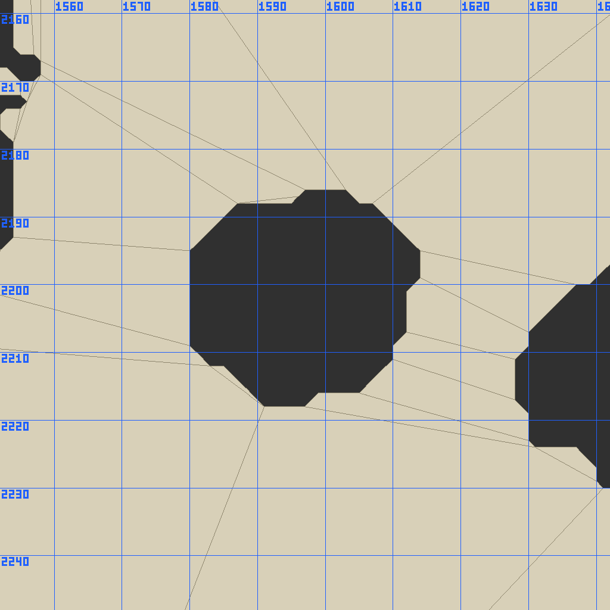
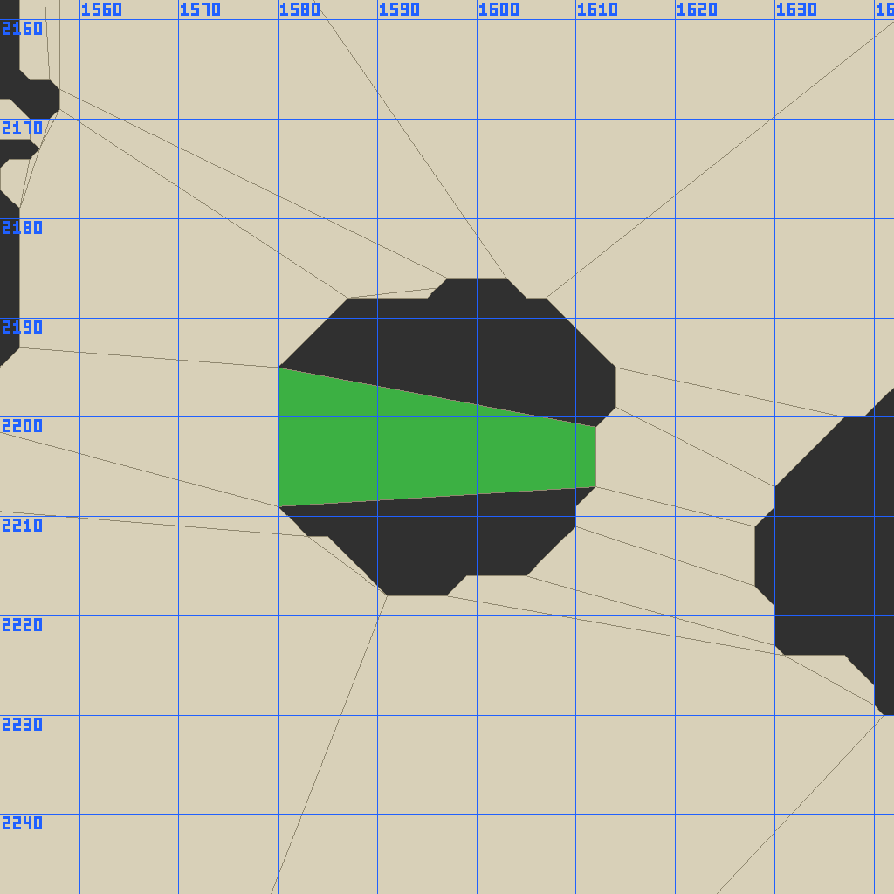
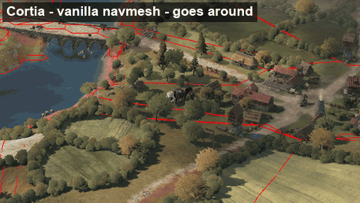
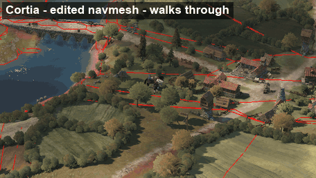
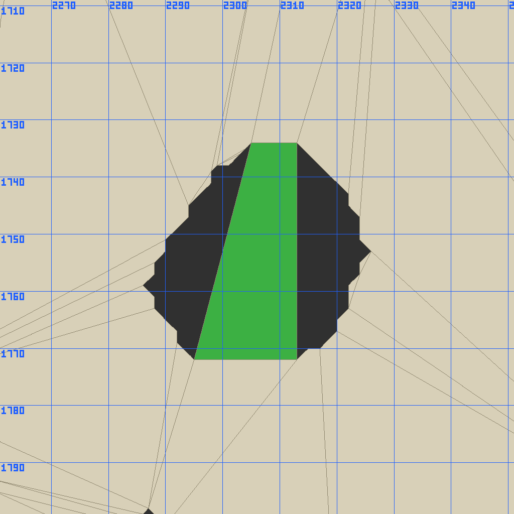

# navtool — дороги сквозь города на карте мира Wartales

Армия на карте мира ходит только по `assets/worldmap/collides/navmesh.dat` (навмеш из выпуклых ячеек). Каждый город в нём — «дыра», поэтому армия обходит город. `navtool` добавляет в навмеш проходимые ячейки-«мосты» через город. Файлы `.prefab` города не трогаются.

| Ванильный навмеш | С мостом (`navtool png ... example-spec.txt`) |
|---|---|
|  |  |

В игре (Кортия): ваниль — армия обходит город, с мостом — идёт насквозь.

 

## Команды

```
navtool holes <navmesh.dat> [x y радиус]              список дыр (города, скалы, озёра): центр, площадь, размер
navtool png   <navmesh.dat> <x> <y> <радиус> <out.png> [spec.txt]   картинка области; со spec новые ячейки зелёные
navtool apply <ванильный navmesh.dat> <spec.txt> <новый navmesh.dat>
```

`spec.txt` — по команде на строку, `#` — комментарий. Команда одна:
`bridge x1 y1 x2 y2` — ячейка от края города, ближайшего к точке 1, до края, ближайшего к точке 2 (одна прямая дорога: вход → выход). Пример: [example-spec.txt](example-spec.txt).

## Пошагово

1. **Ванильный файл.** Достаньте quickbms из `assets.pak` файл `assets/worldmap/collides/navmesh.dat` (как и другие файлы). Всегда работайте от *ванильного* файла.
2. **Найдите город.** Координаты всех городов: [docs/towns.md](docs/towns.md). Или: `x`/`y` города в `content/regions/<Регион>/POI/Region*.prefab`, затем `navtool holes navmesh.dat <x> <y> 40` — покажет дыру города.
3. **Картинка.** `navtool png navmesh.dat 1597 2203 45 town.png` — светлое = проходимо, тёмное = дыры, синяя сетка подписана координатами (x растёт вправо, y растёт вниз, как на карте мира).
4. **Spec.** Выберите две точки на краю тёмной дыры, где дорога входит и выходит (до края ≤ 10 единиц), запишите `bridge x1 y1 x2 y2`.
5. **Проверка.** `navtool png navmesh.dat 1597 2203 45 check.png spec.txt` — мост зелёный.
6. **Сборка.** `navtool apply navmesh.dat spec.txt navmesh.new` → `line 1: new cell 184806 joins cells 95516 and 99895`.
7. **Импорт.** Верните `navmesh.new` под именем `navmesh.dat` в `assets.pak` через quickbms. Новый файл больше ванильного (+68 байт на мост) — нужен `reimport2`.
8. **В игре.** Приказ идти на другую сторону города — армия идёт прямо через мост, в город не заходит и не останавливается. Зайти в город по клику можно как раньше.



## Правила (navtool проверяет сам и пишет, что не так)

- Мост соединяет два разных края одной дыры; ячейка должна быть выпуклой и целиком лежать в дыре (не налезать на проходимую землю и не пересекать чужие рёбра). Иначе — ошибка с номером строки spec, файл не пишется.
- Несколько мостов в одном городе можно: следующий может начинаться от бокового края предыдущего (развилка/изгиб). Пересекаться мосты не могут.
- Номера новых ячеек = максимальный номер в файле + 1. Применяйте spec только к ванильному файлу: повторный прогон по уже изменённому файлу будет отклонён.
- `water_navmesh.dat` (вода) не меняется.

## Нужно ли менять .prefab города?

Нет. Проходимость берётся только из `navmesh.dat`: игра загружает его при каждой загрузке мира. Правка `Collide` в `.prefab` проходимость не меняет — навмеш пересобирается, только если меняется хэш рельефа (16 байт в начале файла), а он от городов не зависит; принудительная пересборка вешает игру. `navtool` эти 16 байт не трогает.

## После обновления игры

- Формат файла — сериализатор библиотеки движка (`shiro.navmesh.Serializer`), а не данные игры; игра грузит его из `assets.pak` по пути `assets/worldmap/collides/navmesh.dat`. Если формат когда-нибудь изменится, `navtool` откажется читать файл, а не испортит его.
- Если обновление поменяло `navmesh.dat` (новые регионы, правки карты): снова достаньте *новый* ванильный файл и прогоните тот же spec. Spec задан координатами, а не номерами ячеек, поэтому переживает перенумерацию и новые ячейки.
- Если у города изменился контур, мост либо привяжется к новым краям, либо `apply` откажет с понятной ошибкой — поправьте точки по новой картинке `png`.
- Новые регионы: проверьте их города по `holes`/`png` (у некоторых городов нет отдельной дыры — см. пустые строки в [docs/towns.md](docs/towns.md)).

## Как распространять мод

- Игрокам не нужен весь `assets.pak` (11 ГБ). Выкладывайте только собранный `navmesh.dat` (~4 МБ) и `.bat` с quickbms, который импортирует его в *их* `assets.pak` (`reimport2`, т.к. файл больше оригинала) — как у WR Visuals.
- Проверка файлов в Steam или обновление игры возвращает ванильный файл — игрок просто запускает `.bat` снова.
- Если обновление изменило `navmesh.dat`, сначала пересоберите файл из нового ванильного и выложите его. Старый файл поверх новой игры затрёт новые данные карты.
- В кооперативе ставьте файл всем игрокам.

## Проверено (Wartales 1.0.48274)

- Чтение/запись ванильного файла байт-в-байт (`go test`, переменная `NAVMESH` = путь к файлу).
- `navmesh.dat` с `example-spec.txt`, вставленный в `assets.pak` (новые данные дописаны в конец, запись указывает на них — то же, что делает `reimport2`): армия проходит насквозь Кортию (T2, запад → восток) и Стромкапп (T1, север → юг); в город не заходит.
- Сам `.bat`/quickbms `reimport2` здесь не проверялся — это ваш рабочий процесс.

Сборка из исходников: Go 1.22+, `go build`.
